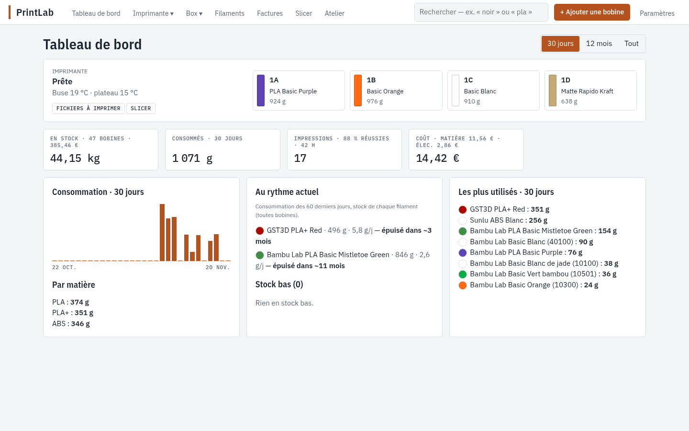
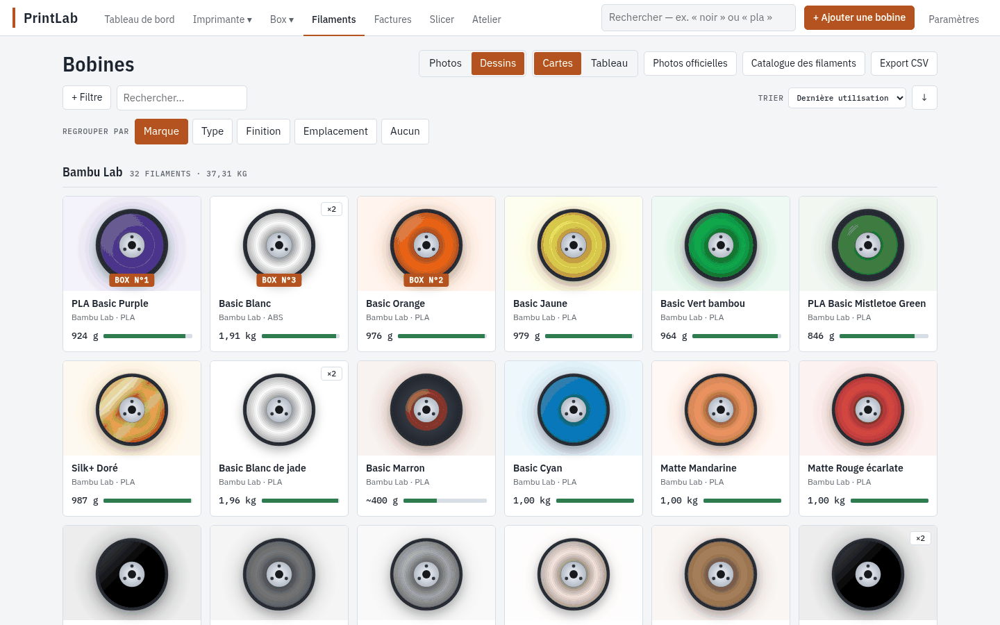
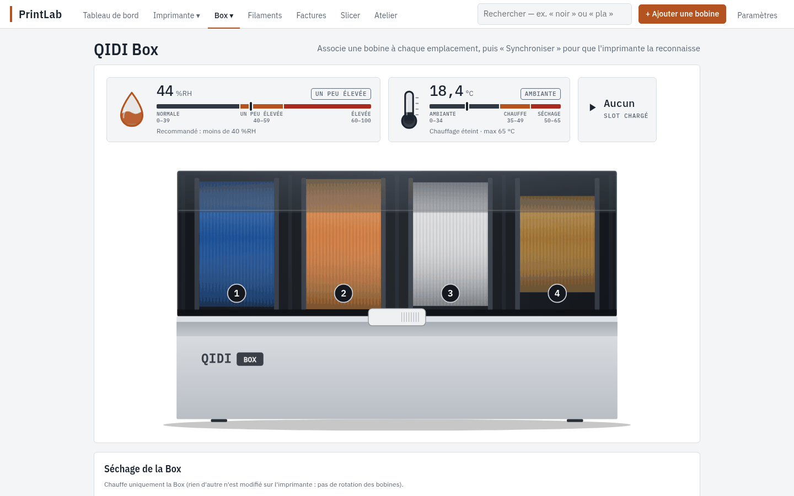
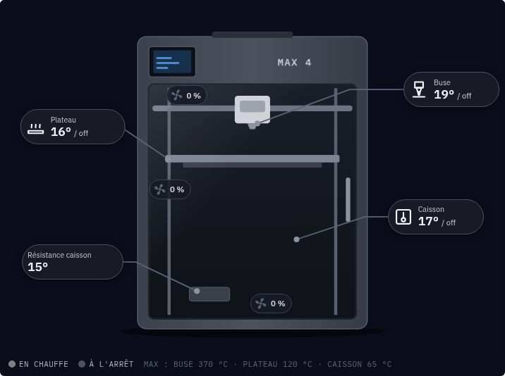
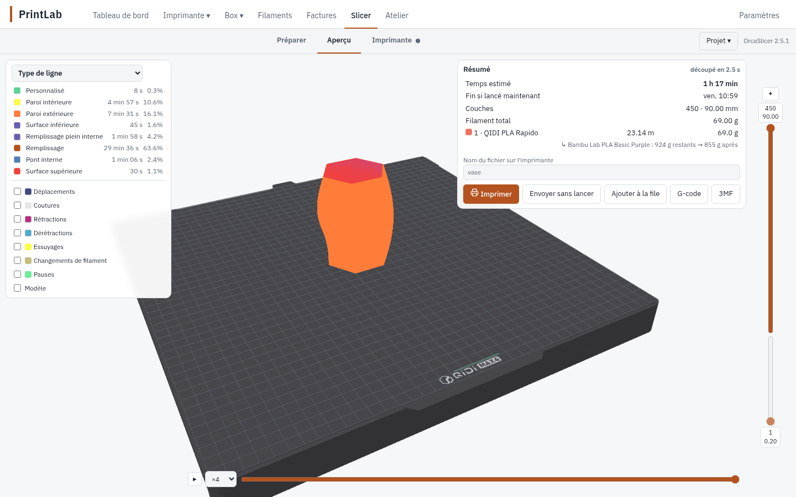
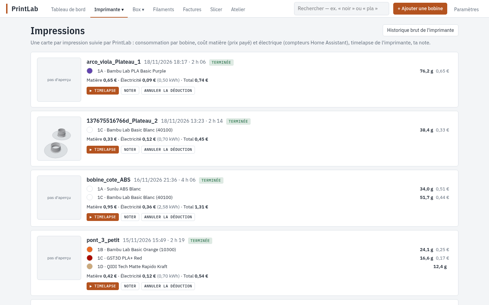

<div align="center">

# PrintLab

**Your 3D printer's workshop in a browser: spools, printer, QIDI Box and Slicer, all in one place.**

Self-hosted · Docker · Klipper / Moonraker · built for the **QIDI Max 4** and the **QIDI Box**

🇬🇧 English · [🇫🇷 Français](README.md)

[Features](#-features) · [Installation](#-installation) · [Configuration](#%EF%B8%8F-configuration) · [Updating](#-updating) · [FAQ](#-faq) · [License](#-license)

</div>

<p align="center"></p>

---

## Contents

- [Why PrintLab?](#-why-printlab)
- [Screenshots](#-screenshots)
- [Features](#-features)
- [Compatibility](#-compatibility)
- [Installation](#-installation)
- [Configuration](#%EF%B8%8F-configuration)
- [Connecting Moonraker to PrintLab](#-connecting-moonraker-to-printlab)
- [Security](#%EF%B8%8F-security)
- [Backup and restore](#-backup-and-restore)
- [Updating](#-updating)
- [Building the image yourself](#%EF%B8%8F-building-the-image-yourself)
- [API](#-api)
- [Troubleshooting](#-troubleshooting)
- [FAQ](#-faq)
- [Contributing](#-contributing)
- [Credits](#-credits)
- [License](#-license)

---

## 💡 Why PrintLab?

With a multi-color printer you quickly end up juggling several tools: Spoolman for stock, Fluidd or Mainsail for the
printer, the machine's screen for the Box, a slicer on your PC… and none of them really knows what is on each spool.

PrintLab brings all of that together in **a single web interface**, on desktop as well as on your phone:

- you know **how much is left** on each spool, and usage is **deducted automatically** after every print;
- you see **what is loaded in the Box**, and you can **sync it with the printer** in one click;
- you **slice and start** your prints from the browser, with the spools actually loaded in the Box.

By default, PrintLab **only reads** the printer's state. Write actions (pause, start, file deletion…) stay disabled
until you enable them yourself.

The interface is available in **English and French** (**Settings → Appearance → Language**; it follows your browser language by default).

---

## 📸 Screenshots

| | |
|:---:|:---:|
| <br>**Spools**: stock, remaining weight, location in the Box | <br>**QIDI Box**: level of the 4 spools, humidity, temperature, drying |
| <br>**Printer**: live drawn view (temperatures, fans) | <br>**Slicer**: OrcaSlicer slicing in the browser, then send to the printer |
| <br>**Prints**: usage per spool, material and electricity cost | <br>**Dashboard**: stock, usage, forecasts |

*(screenshots shown with the French interface)*

## ✨ Features

### 🧵 Spools and filaments
- Brands, filaments (material, finish, single or multi-color, density, temperatures) and spools (weight, price, batch, location).
- **"New spool" wizard**: brand → material → line → color, powered by a **built-in catalog** of about 6,000 colors
  ([SpoolmanDB](https://github.com/Donkie/SpoolmanDB)) that fills in density, temperatures and tare.
- **Weighing**: enter the gross weight, PrintLab subtracts the empty spool tare and corrects the stock.
- **Weight reliability**: each spool shows whether its weight comes from weighing, print tracking or an estimate; "To weigh" filter.
- Spools drawn in their color and finish (silk, matte, sparkle, multicolor…), or **official photos** found automatically
  (Bambu Lab, Shopify shops such as Sunlu, QIDI, Elegoo…).
- History of every movement, **editable** (fix, move to another spool, delete).
- Search, sorting, grouping, CSV export, low stock alerts.

### 🧾 Invoices
- Drop a **PDF invoice**: PrintLab reads it (automatic reading of Bambu Lab invoices, guided entry for others),
  suggests the spools to create with the **price actually paid** (discounts and shipping split), then adds them to stock once you confirm.

### 🖨️ Printer (Klipper / Moonraker)
- **Live drawn view** of the printer: nozzle, bed and chamber temperatures, fans animated according to their speed.
- **Camera** relayed by PrintLab (works over HTTPS and away from home), light button.
- Reliable **time left and end time** (slicer estimate + actual progress).
- **Files to print**: thumbnails, plates, filaments and duration read from `.gcode.3mf` files, folders (mosaic preview), duplicates.
  **Drag and drop** to organize, "Move" window with a folder tree, hover actions (select, print, rename, delete) and **multi-select**.
- **Drying at print start**: when starting a print, dry the Box **before** (the print starts by itself when drying ends) or
  **during** the print, with temperature and duration suggested from the file's materials.
- **Print log**: material cost, **electricity cost** (through Home Assistant), ratings, reprint, timelapses.
- **Backups** of the printer's configuration files.
- Write actions **disabled by default**: pause, resume, cancel, start, file management, with server-side safeguards
  (refused during a print, checked paths…).

### 📦 QIDI Box
- **Box view** with the real color of each slot and the **remaining level** of each spool.
- **Slot ↔ spool** assignment, detection of mismatches with what the printer thinks it has.
- **Sync with the printer**: sends brand, material and color to the Box (like an RFID tag), without any movement.
- **Backup spool**: declare a spool identical to another one so the Box switches to it when the first runs out,
  with usage still counted correctly.
- **Usage tracking per slot** during the print, end of spool detected.
- Box **drying** (temperature, duration, automatic stop based on humidity), live humidity and temperature.
- **RFID tags** (MIFARE Classic, BoxRFID format): write them from your phone through a USB reader or an ESP32 + PN532 module,
  automatic assignment when the Box reads the tag. See [docs/RFID.md](docs/RFID.md) (French).
- **Original Bambu Lab chips**: with the **QIDI Box firmware from [Valve Oil](https://github.com/thelegendtubaguy/valve-oil)**
  (third-party project, installed separately), the Box reads the original RFID chips of Bambu Lab spools and PrintLab automatically
  links the slot to the right spool of your stock. Install and rollback: [docs/RFID.md](docs/RFID.md#puces-dorigine-bambu-lab-micrologiciel-box-de-valve-oil--original-bambu-lab-chips).

### ✂️ Slicer (OrcaSlicer in the browser)
- The **engine is the real OrcaSlicer** (command line, inside the container): same G-code as Orca for the same project.
- Multiple plates, STL / 3MF / STEP / OBJ import, opening and saving Orca-compatible `.3mf` projects.
- System and user presets, Simple / Advanced / Developer levels, "My filaments", "My printers".
- Multi-color: purge computed like Orca, prime tower, per-layer changes, **painting** of colors, seams and supports.
- Tools: cut with connectors, auto orientation, embossed text and SVG, booleans, simplification, variable layer height…
- Layer **preview** (14 views, animated playback), Orca **calibrations** (temperature, flow, pressure advance, retraction…).
- Send to the printer with **choice of Box slots** per tool.
- Detailed roadmap: [ROADMAP-SLICER.md](ROADMAP-SLICER.md) (French).

### 🔧 Workshop and more
- **Workshop**: maintenance tracking based on actual print hours.
- **3D model search** on Printables, Thingiverse, MakerWorld, Cults, etc. from a single bar.
- **Alerts** (print finished, end of spool, low stock…) to Home Assistant (mobile notification, Discord, etc.).
- **Spoolman-compatible API**: Moonraker can use PrintLab instead of Spoolman.
- **Spoolman import** to bring over an existing database.
- 10 themes (light, dark, high contrast…), English / French (**Settings → Appearance**).

### 📱 On your phone
- **Installable app** (PWA): on iPhone, Safari → Share → "Add to Home Screen"; on Android, Chrome offers "Install app". No store:
  icon, full screen, **bottom tab bar** (Home, Printer, Files, Box, More).
- The session is extended each time you use it: no password to retype. PrintLab must be served over **HTTPS**
  (see [Behind a reverse proxy](#behind-a-reverse-proxy-https)).

---

## ✅ Compatibility

| Hardware / software | Status |
|---|---|
| **QIDI Max 4 + QIDI Box** (firmware 01.01.07.01) | Used daily |
| QIDI Box + **Valve Oil Box firmware** | Reads original Bambu Lab chips (tested with Valve Oil 26.11.18.2) |
| Other **Klipper + Moonraker** printer | Spool management, tracking, files, camera and Slicer work; Box features are specific to the QIDI Box |
| No printer | PrintLab works as a plain spool and invoice manager |
| Server | Linux with Docker, **x86-64** architecture (OrcaSlicer is only released for x86-64 on Linux) |
| Browsers | Recent Chrome, Edge, Firefox, Safari (desktop and mobile) |

Resources: plan for about **2 GB of RAM** (the Slicer uses it while slicing) and **2 GB of disk** for the image.

---

## 🚀 Installation

### Requirements
- A Linux x86-64 server with **Docker** and **Docker Compose** (a NAS or a mini-PC; a Raspberry Pi won't do because of OrcaSlicer).
- Your printer reachable on the network (Moonraker, port 7125 by default), if you want more than spool management.

### Steps

```bash
mkdir printlab && cd printlab
curl -LO https://raw.githubusercontent.com/percolouco/printlab/main/docker-compose.yml
curl -L  https://raw.githubusercontent.com/percolouco/printlab/main/.env.example -o .env
nano .env                 # set at least APP_PASSWORD
mkdir -p data && sudo chown 1000:1000 data
docker compose up -d
```

Then open **http://\<server-ip\>:7913**, log in with your password and go to **Settings**:

1. **Printer address**: your machine's IP (e.g. `192.168.1.50`), **Test** button.
2. **My brands** and **My materials**: tick what you use, to keep the wizard short.
3. Add your spools (**+ Add a spool** button, or **Invoices**, or **Spoolman import**).
4. **QIDI Box** page: assign a spool to each slot.

> The `data/` folder holds your whole database. The container runs as user `1000:1000`: the folder must belong to it.
> For another user, change `user:` in `docker-compose.yml` and the folder's owner.

### Behind a reverse proxy (HTTPS)
PrintLab works fine behind Traefik, Nginx Proxy Manager, Caddy, etc. Remember to:
- set `FORWARDED_ALLOW_IPS` in `.env` (your proxy's IP, or `*` if only the proxy can reach the container);
- not publish port 7913 on the Internet without an HTTPS proxy in front.

Example Traefik labels:
```yaml
    labels:
      - traefik.enable=true
      - traefik.http.routers.printlab.rule=Host(`printlab.example.com`)
      - traefik.http.routers.printlab.entrypoints=websecure
      - traefik.http.routers.printlab.tls.certresolver=letsencrypt
      - traefik.http.services.printlab.loadbalancer.server.port=8000
```

---

## ⚙️ Configuration

### Environment variables (`.env`)

| Variable | Required | Purpose |
|---|---|---|
| `APP_PASSWORD` | **yes** | Interface password. Without it, nobody can log in. |
| `SECRET_KEY` | no | Session signing key. Empty: a random key is created in `data/secret_key`. |
| `API_TOKEN` | no | API token (`Authorization: Bearer …`) for scripts and home automation. |
| `MOONRAKER_URL` | no | Printer address if you prefer `.env` over the Settings page (the page takes priority). |
| `MOONRAKER_API_KEY` | no | Moonraker API key, only if your Moonraker requires one. |
| `SPOOLMAN_URL` | no | Old Spoolman instance, for the import. |
| `HA_URL`, `HA_TOKEN` | no | Home Assistant: alerts and electricity cost of prints. |
| `THINGIVERSE_TOKEN` | no | Thingiverse search in PrintLab (free app token). |
| `FORWARDED_ALLOW_IPS` | no | Trusted proxies for `X-Forwarded-*` headers (default `127.0.0.1`). |
| `DEFAULT_MACHINE` | no | Printer preset offered by default in the Slicer. |
| `SLICE_CONCURRENCY`, `SLICE_TIMEOUT` | no | Simultaneous slicing jobs (default 2) and max slicing time in seconds (default 1800). |
| `TZ` | no | Time zone (e.g. `Europe/London`). |

### Settings page
Everything else is set in the interface: printer address, write actions, low stock threshold, currency, themes,
brands and materials shown, Home Assistant alerts (notification services, cost and energy entities),
RFID encoder, automatic usage deduction, etc. The language is switched in **Settings → Appearance → Language**.

---

## 🔗 Connecting Moonraker to PrintLab

PrintLab already tracks prints on its own (reading Moonraker). If you also want **Fluidd / Mainsail / Moonraker**
to see your spools as with Spoolman, PrintLab exposes a **Spoolman-compatible API**:

```ini
# moonraker.conf
[spoolman]
server: http://<server-ip>:7913
```

This API (`/api/v1/…`) is open **without a password only for direct access from the local network** (not through the reverse proxy).
Edit `moonraker.conf` while the printer is not printing, then restart Moonraker.

---

## 🛡️ Security

- **Password required** on the whole interface; 5 failed attempts block login for 5 minutes.
- **Read-only by default** towards the printer: write actions must be enabled explicitly in Settings,
  and the server refuses risky operations (starting during a print, deleting the file being printed…).
- **Box sync** and file actions are refused during a print.
- **Don't expose PrintLab directly to the Internet**: use an HTTPS reverse proxy, a VPN (WireGuard, Tailscale…)
  or at least keep it on your local network. The Spoolman-compatible API port must not be exposed.
- Your `.env` and your `data/` folder must never be published.

Found a vulnerability? Please report it privately through [GitHub Security Advisories](https://github.com/percolouco/printlab/security/advisories/new)
rather than in a public issue.

---

## 💾 Backup and restore

Everything is in the `data/` folder:

| Path | Content |
|---|---|
| `data/printlab.db` | the database (spools, filaments, history, settings, prints) |
| `data/images/` | filament photos |
| `data/invoices/` | PDF invoices |
| `data/slicer/` | Slicer user presets, projects and favorites |
| `data/secret_key` | generated session key (if `SECRET_KEY` is empty) |

Backup:
```bash
docker compose stop printlab && tar czf printlab-$(date +%F).tgz data .env && docker compose start printlab
```
Restore: put back the `data/` folder and `.env`, then `docker compose up -d`.

---

## 🔄 Updating

```bash
docker compose pull && docker compose up -d
```

- Each release has its own **tag** (`ghcr.io/percolouco/printlab:1.3.0`). To stay in control, pin a version in
  `docker-compose.yml` and change it when you decide.
- The database is migrated automatically on start-up. **Back up first** before a major update.
- Avoid updating **during a print**: tracking resumes after the restart, but better safe than sorry.
- Changes are listed in [CHANGELOG.md](CHANGELOG.md).

---

## 🏗️ Building the image yourself

```bash
git clone https://github.com/percolouco/printlab.git && cd printlab
docker build -t printlab:local .                                   # latest OrcaSlicer
docker build --build-arg ORCA_VERSION=v2.5.1 -t printlab:local .   # specific version
```

The image downloads OrcaSlicer from its [official releases](https://github.com/OrcaSlicer/OrcaSlicer/releases) during the build.
The `scripts/update-orca.sh` script automates upgrading Orca with a self-test and a regression check
(`tools/regress.py`) before switching.

### Development
- Back end: **FastAPI** + **SQLite** (`app/`), front end: **framework-free JavaScript** (`app/static/`), Slicer: `app/slicer/` (three.js).
- Translations: the interface is written in French; `app/static/i18n-en.js` holds the French → English dictionary
  (`{}` = inserted value) and `app/static/i18n.js` applies it on the fly.
- Run the tests: `python3 tools/test_eta.py`, `tools/test_flush.py`, `tools/test_project3mf.py`, `tools/test_tools3d.py`
  (the last three inside the container, which has OrcaSlicer and the 3D dependencies).

---

## 🔌 API

All interface routes are JSON APIs under `/api/…` (and `/slicer/api/…` for the Slicer), usable with
`Authorization: Bearer <API_TOKEN>`. A few examples:

```bash
T=your_api_token
curl -H "Authorization: Bearer $T" http://printlab:7913/api/spools          # spools
curl -H "Authorization: Bearer $T" http://printlab:7913/api/box             # Box state
curl -H "Authorization: Bearer $T" http://printlab:7913/api/printer         # printer state
curl -X POST -H "Authorization: Bearer $T" -H 'Content-Type: application/json' \
     -d '{"gross_weight": 812}' http://printlab:7913/api/spools/12/measure  # weighing
```

---

## 🩺 Troubleshooting

| Symptom | What to check |
|---|---|
| Can't log in | Is `APP_PASSWORD` set in `.env`? Recreate the container after changing it (`docker compose up -d`). |
| I have to log in again after every restart | The `data/` folder is not writable: check its owner (`1000:1000`). Or set `SECRET_KEY`. |
| "Printer unreachable" | Test the address in Settings; from the server: `curl http://IP:7125/server/info`. |
| The camera doesn't show | Check that it is declared in Moonraker (`/server/webcams/list`). |
| The Slicer fails or stops | Not enough memory: check `shm_size: 512mb` and available RAM; see `docker logs printlab`. |
| The Box shows "?" or empty menus in Fluidd | Don't edit the Box from Fluidd; use the screen, QIDI Studio or "Sync" in PrintLab. |
| Blank page after an update | Reload without cache (Ctrl+F5). |

Logs: `docker logs -f printlab`.

---

## ❓ FAQ

**Does PrintLab replace Spoolman?**
Yes: spools, filaments, brands, history, and a compatible API for Moonraker. Importing from Spoolman is built in.

**Does PrintLab change anything on my printer?**
Never without an action from you. PrintLab reads the state continuously, but only writes when you ask it to: turn on the light,
sync or set a Box slot as backup, start drying, send a print from the Slicer.
More sensitive actions (pause, cancel, starting and deleting files from the Files page) must also
be enabled in Settings.

**Do I need a GPU for the Slicer?**
No. Slicing runs on the server's CPU; the 3D view runs in your browser.

**My printer isn't a QIDI, does it work?**
Everything that goes through Klipper/Moonraker works. The pages and features specific to the QIDI Box won't be useful to you.

**Is the interface available in English?**
Yes, since version 1.1: go to **Settings → Appearance → Language** (English is chosen automatically if your browser isn't in French).
Spotted a French word left over or a clumsy translation? Open an issue or a pull request on `app/static/i18n-en.js`.

---

## 🤝 Contributing

Issues and pull requests are welcome:
- describe the problem with your setup (printer, firmware, PrintLab version) and the logs (`docker logs printlab`);
- for a significant new feature, open an issue first to discuss it;
- keep the existing style (no front-end framework, no heavy dependency without a reason).

By contributing, you agree that your contribution is published under the project's AGPL-3.0 license.

---

## 🙏 Credits

- [OrcaSlicer](https://github.com/OrcaSlicer/OrcaSlicer) (AGPL-3.0): slicing engine, presets and resources (plates) used by the Slicer.
- [SpoolmanDB](https://github.com/Donkie/SpoolmanDB) (MIT): filament catalog.
- [Bambu Studio](https://github.com/bambulab/BambuStudio) (AGPL-3.0): Bambu Lab color code mapping.
- [three.js](https://threejs.org) and [three-mesh-bvh](https://github.com/gkjohnson/three-mesh-bvh) (MIT): 3D in the browser.
- [manifold3d](https://github.com/elalish/manifold), [trimesh](https://github.com/mikedh/trimesh), [FastAPI](https://fastapi.tiangolo.com) and the other dependencies listed in `requirements.txt`.
- RFID tag format taken from BoxRFID (TinkerBarn).
- [Valve Oil](https://github.com/thelegendtubaguy/valve-oil) (GPL-3.0, thelegendtubaguy): QIDI Box firmware and Klipper module that make
  original Bambu Lab chips readable. Not included in PrintLab; PrintLab uses what the Box reports.
- Klipper, Moonraker, Fluidd and the QIDI Max 4 community.

PrintLab is an independent project, **not affiliated with QIDI Technology**. QIDI, Max 4 and QIDI Box are trademarks of their owners,
mentioned only to indicate compatibility.

---

## 📄 License

PrintLab is distributed under the **GNU Affero General Public License v3.0** ([LICENSE](LICENSE)), like the OrcaSlicer it embeds.

In short: you can use, modify and redistribute PrintLab freely. If you distribute a modified version, **or offer it
to other people over a network**, you must publish your source code under the same license.

This software is provided **without any warranty**. It drives a machine that heats up and moves: keep an eye on your printer.
