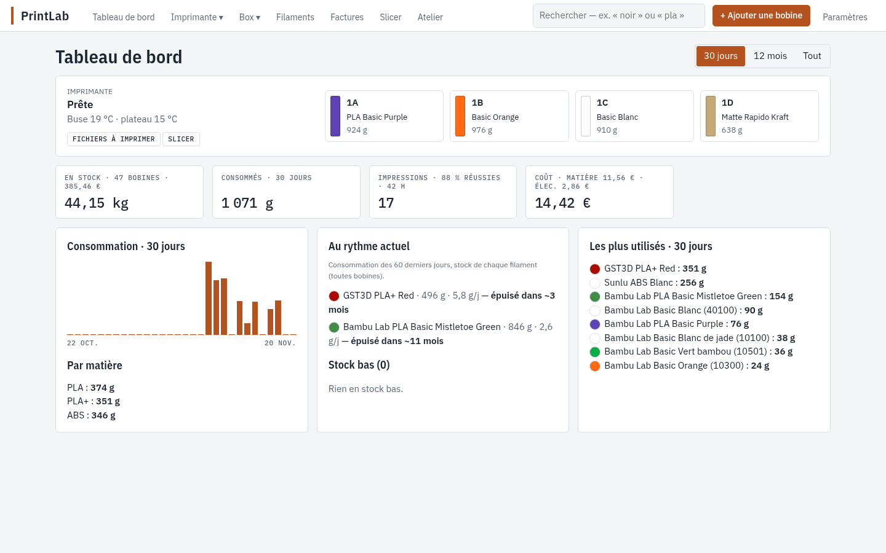
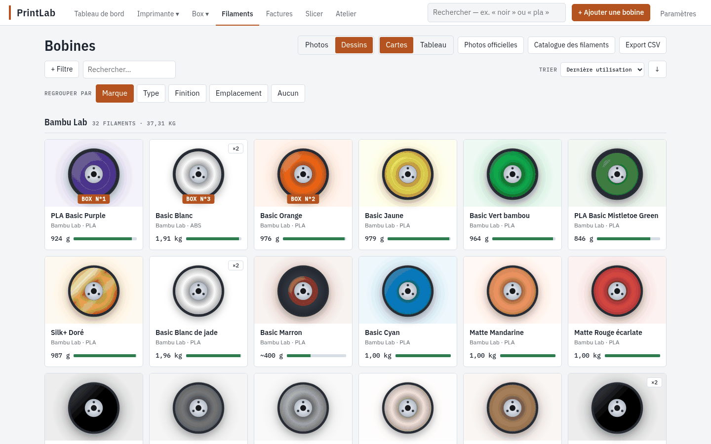
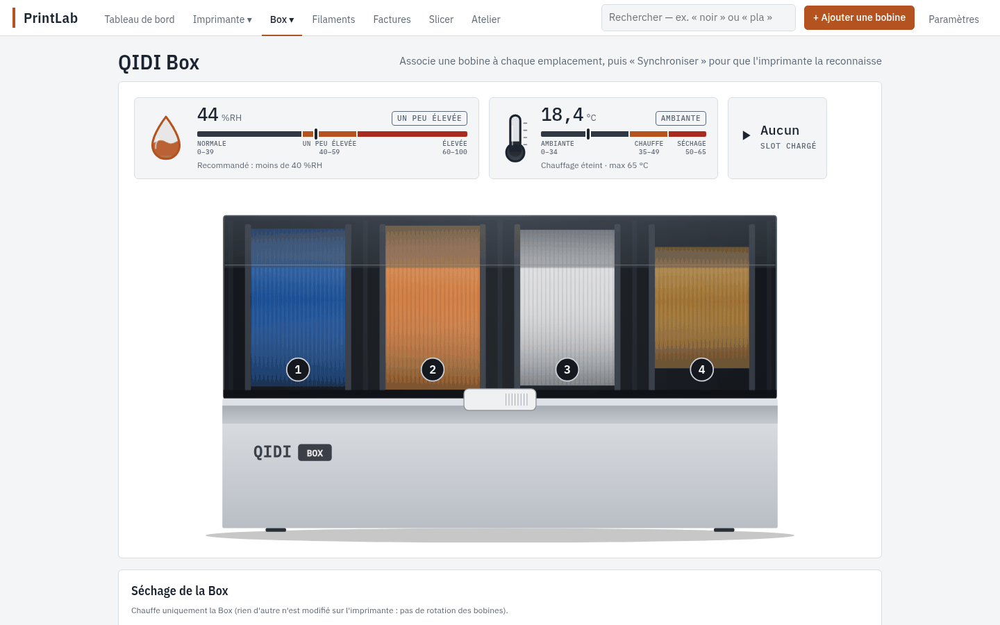
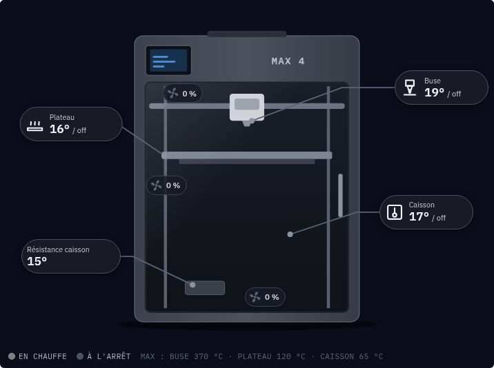
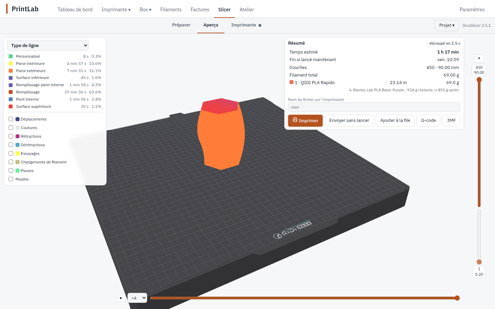
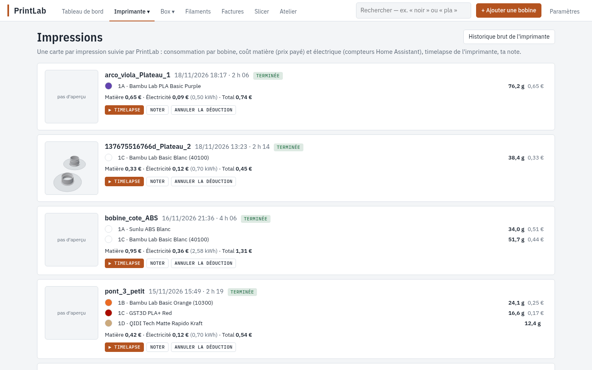

<div align="center">

# PrintLab

**L'atelier de ton imprimante 3D dans un navigateur : bobines, imprimante, QIDI Box et Slicer, au même endroit.**

Auto-hébergé · Docker · Klipper / Moonraker · pensé pour la **QIDI X-Max 4** et la **QIDI Box**

🇫🇷 Français · [🇬🇧 English](README.en.md)

[Fonctionnalités](#-fonctionnalités) · [Installation](#-installation) · [Configuration](#%EF%B8%8F-configuration) · [Mise à jour](#-mise-à-jour) · [FAQ](#-faq) · [Licence](#-licence)

</div>

> **English** — PrintLab is a self-hosted web app (Docker) to manage filament spools, monitor and drive a Klipper/Moonraker
> 3D printer, manage the QIDI Box and slice with a built-in web front-end for OrcaSlicer. The interface is available in
> English and French. 👉 [Read the English README](README.en.md).

<p align="center"></p>

---

## Sommaire

- [Pourquoi PrintLab ?](#-pourquoi-printlab-)
- [Captures d'écran](#-captures-décran)
- [Fonctionnalités](#-fonctionnalités)
- [Compatibilité](#-compatibilité)
- [Installation](#-installation)
- [Configuration](#%EF%B8%8F-configuration)
- [Brancher Moonraker sur PrintLab (suivi automatique)](#-brancher-moonraker-sur-printlab)
- [Sécurité](#-sécurité)
- [Sauvegarde et restauration](#-sauvegarde-et-restauration)
- [Mise à jour](#-mise-à-jour)
- [Construire l'image soi-même](#-construire-limage-soi-même)
- [API](#-api)
- [Dépannage](#-dépannage)
- [FAQ](#-faq)
- [Contribuer](#-contribuer)
- [Crédits](#-crédits)
- [Licence](#-licence)

---

## 💡 Pourquoi PrintLab ?

Avec une imprimante multi-couleurs, on jongle vite entre plusieurs outils : Spoolman pour le stock, Fluidd ou Mainsail pour
l'imprimante, l'écran de la machine pour la Box, un slicer sur le PC… et aucun ne sait vraiment ce que contient chaque bobine.

PrintLab réunit tout ça dans **une seule interface web**, utilisable aussi bien sur ordinateur que sur téléphone :

- tu sais **combien il reste** sur chaque bobine, et la consommation est **déduite toute seule** à chaque impression ;
- tu vois **ce qui est chargé dans la Box**, et tu peux le **synchroniser avec l'imprimante** en un clic ;
- tu **découpes et lances** tes impressions depuis le navigateur, avec les bobines réellement présentes dans la Box.

Par défaut, PrintLab **ne fait que lire** l'état de l'imprimante. Les actions d'écriture (pause, lancement, suppression de
fichiers…) sont désactivées tant que tu ne les actives pas toi-même.

L'interface existe en **français et en anglais** (bouton EN / FR dans la barre du haut ; par défaut, la langue du navigateur).

---

## 📸 Captures d'écran

| | |
|:---:|:---:|
| <br>**Bobines** : stock, poids restant, emplacement dans la Box | <br>**QIDI Box** : niveau des 4 bobines, humidité, température, séchage |
| <br>**Imprimante** : vue dessinée en direct (températures, ventilateurs) | <br>**Slicer** : découpe OrcaSlicer dans le navigateur, puis envoi à l'imprimante |
| <br>**Impressions** : consommation par bobine, coût matière et électrique | <br>**Tableau de bord** : stock, consommation, prévisions |

## ✨ Fonctionnalités

### 🧵 Bobines et filaments
- Fabricants, filaments (matière, finition, couleur unie ou multicolore, densité, températures) et bobines (poids, prix, lot, emplacement).
- **Assistant « Nouvelle bobine »** : marque → matière → gamme → couleur, alimenté par un **catalogue intégré** d'environ 6 000 couleurs
  ([SpoolmanDB](https://github.com/Donkie/SpoolmanDB)) qui remplit densité, températures et tare.
- **Pesée** : saisis le poids brut, PrintLab retire la tare de la bobine vide et recale le stock.
- **Fiabilité du poids** : chaque bobine indique si son poids vient d'une pesée, d'un suivi d'impression ou d'une estimation ; filtre « À peser ».
- Bobines dessinées dans leur couleur et leur finition (silk, mat, pailleté, multicolore…), ou **photos officielles** trouvées automatiquement
  (Bambu Lab, boutiques Shopify comme Sunlu, QIDI, Elegoo…).
- Historique de chaque mouvement, **modifiable** (corriger, déplacer vers une autre bobine, supprimer).
- Recherche, tris, regroupements, export CSV, alertes de stock bas.

### 🧾 Factures
- Dépose une **facture PDF** : PrintLab la lit (lecture automatique des factures Bambu Lab, saisie guidée pour les autres),
  propose les bobines à créer avec le **prix réellement payé** (remises et livraison réparties), puis les intègre au stock après validation.

### 🖨️ Imprimante (Klipper / Moonraker)
- **Vue en direct** de l'imprimante dessinée : températures de la buse, du plateau, du caisson, ventilateurs animés selon leur vitesse.
- **Caméra** relayée par PrintLab (visible en HTTPS et hors de chez toi), bouton d'éclairage.
- **Temps restant et heure de fin** fiables (estimation du slicer + progression réelle).
- **Fichiers à imprimer** : vignettes, plateaux, filaments et durée lus dans les `.gcode.3mf`, dossiers, doublons.
- **Journal des impressions** : coût matière, **coût électrique** (via Home Assistant), notes, relance, timelapses.
- **Sauvegardes** des fichiers de configuration de l'imprimante.
- Actions d'écriture **désactivées par défaut** : pause, reprise, annulation, lancement, gestion des fichiers, avec garde-fous côté serveur
  (refus pendant une impression, chemins vérifiés…).

### 📦 QIDI Box
- **Vue de la Box** avec la vraie couleur de chaque emplacement et le **niveau restant** de chaque bobine.
- Association **emplacement ↔ bobine**, détection des écarts avec ce que l'imprimante croit avoir.
- **Synchroniser avec l'imprimante** : envoie marque, matière et couleur à la Box (comme une étiquette RFID), sans aucun mouvement.
- **Bobine de relais** : déclare une bobine identique à une autre pour que la Box bascule dessus quand la première est vide,
  avec un décompte qui reste juste.
- **Suivi de consommation par emplacement** pendant l'impression, fin de bobine détectée.
- **Séchage** de la Box (température, durée, arrêt automatique selon l'humidité), humidité et température en direct.
- **Étiquettes RFID** (MIFARE Classic, format BoxRFID) : écriture depuis le téléphone via un lecteur USB ou un module ESP32 + PN532,
  association automatique quand la Box lit l'étiquette. Voir [docs/RFID.md](docs/RFID.md).

### ✂️ Slicer (OrcaSlicer dans le navigateur)
- Le **moteur est le vrai OrcaSlicer** (en ligne de commande, dans le conteneur) : même G-code qu'Orca pour le même projet.
- Plateaux multiples, import STL / 3MF / STEP / OBJ, ouverture et enregistrement de projets `.3mf` compatibles Orca.
- Profils système et utilisateur, niveaux Simple / Avancé / Développeur, « Mes filaments », « Mes imprimantes ».
- Multi-couleurs : purge calculée comme Orca, tour de purge, changements par couche, **peinture** des couleurs, coutures et supports.
- Outils : coupe avec connecteurs, orientation automatique, texte et SVG en relief, booléens, simplification, hauteur de couche variable…
- **Aperçu** des couches (14 vues, lecture animée), **calibrations** d'Orca (température, débit, pressure advance, rétraction…).
- Envoi à l'imprimante avec **choix des emplacements de la Box** par outil.
- Feuille de route détaillée : [ROADMAP-SLICER.md](ROADMAP-SLICER.md).

### 🔧 Atelier et le reste
- **Atelier** : suivi de l'entretien selon les heures réelles d'impression.
- **Recherche de modèles 3D** sur Printables, Thingiverse, MakerWorld, Cults, etc. depuis une seule barre.
- **Alertes** (fin d'impression, fin de bobine, stock bas…) vers Home Assistant (notification mobile, Discord, etc.).
- **API compatible Spoolman** : Moonraker peut utiliser PrintLab à la place de Spoolman.
- **Import Spoolman** pour reprendre une base existante.
- 10 thèmes (clair, sombre, contraste élevé…), interface adaptée au téléphone, en français ou en anglais.

---

## ✅ Compatibilité

| Matériel / logiciel | État |
|---|---|
| **QIDI X-Max 4 + QIDI Box** (firmware 01.01.07.01) | Testé au quotidien |
| Autre imprimante **Klipper + Moonraker** | Gestion des bobines, suivi, fichiers, caméra et Slicer fonctionnent ; les fonctions Box sont propres à la QIDI Box |
| Sans imprimante | PrintLab fonctionne comme simple gestionnaire de bobines et de factures |
| Serveur | Linux avec Docker, architecture **x86-64** (OrcaSlicer n'est publié que pour x86-64 sous Linux) |
| Navigateurs | Chrome, Edge, Firefox, Safari récents (ordinateur et mobile) |

Ressources : prévois environ **2 Go de RAM** (le Slicer en consomme pendant une découpe) et **2 Go de disque** pour l'image.

---

## 🚀 Installation

### Prérequis
- Un serveur Linux x86-64 avec **Docker** et **Docker Compose** (un NAS, un mini-PC, un Raspberry Pi ne convient pas à cause d'OrcaSlicer).
- Ton imprimante joignable sur le réseau (Moonraker, port 7125 par défaut), si tu veux autre chose que la gestion des bobines.

### Étapes

```bash
mkdir printlab && cd printlab
curl -LO https://raw.githubusercontent.com/percolouco/printlab/main/docker-compose.yml
curl -L  https://raw.githubusercontent.com/percolouco/printlab/main/.env.example -o .env
nano .env                 # renseigne au moins APP_PASSWORD
mkdir -p data && sudo chown 1000:1000 data
docker compose up -d
```

Ouvre ensuite **http://\<ip-du-serveur\>:7913**, connecte-toi avec ton mot de passe, puis va dans **Paramètres** :

1. **Adresse de l'imprimante** : l'IP de ta machine (ex. `192.168.1.50`), bouton **Tester**.
2. **Mes marques** et **Mes matières** : coche ce que tu utilises, pour alléger l'assistant.
3. Ajoute tes bobines (bouton **+ Ajouter une bobine**, ou **Factures**, ou **Import Spoolman**).
4. Page **QIDI Box** : associe une bobine à chaque emplacement.

> Le dossier `data/` contient toute ta base. Le conteneur tourne avec l'utilisateur `1000:1000` : le dossier doit lui appartenir.
> Pour un autre utilisateur, change `user:` dans `docker-compose.yml` et le propriétaire du dossier.

### Derrière un reverse proxy (HTTPS)
PrintLab fonctionne très bien derrière Traefik, Nginx Proxy Manager, Caddy, etc. Pense à :
- définir `FORWARDED_ALLOW_IPS` dans `.env` (l'IP de ton proxy, ou `*` si seul le proxy peut joindre le conteneur) ;
- ne pas publier le port 7913 sur Internet sans proxy HTTPS devant.

Exemple d'étiquettes Traefik :
```yaml
    labels:
      - traefik.enable=true
      - traefik.http.routers.printlab.rule=Host(`printlab.example.com`)
      - traefik.http.routers.printlab.entrypoints=websecure
      - traefik.http.routers.printlab.tls.certresolver=letsencrypt
      - traefik.http.services.printlab.loadbalancer.server.port=8000
```

---

## ⚙️ Configuration

### Variables d'environnement (`.env`)

| Variable | Obligatoire | Rôle |
|---|---|---|
| `APP_PASSWORD` | **oui** | Mot de passe de l'interface. Sans lui, personne ne peut se connecter. |
| `SECRET_KEY` | non | Clé de signature des sessions. Vide : une clé aléatoire est créée dans `data/secret_key`. |
| `API_TOKEN` | non | Jeton d'API (`Authorization: Bearer …`) pour scripts et domotique. |
| `MOONRAKER_URL` | non | Adresse de l'imprimante si tu préfères le `.env` à la page Paramètres (la page est prioritaire). |
| `MOONRAKER_API_KEY` | non | Clé API Moonraker, seulement si ton Moonraker en exige une. |
| `SPOOLMAN_URL` | non | Ancienne instance Spoolman, pour l'import. |
| `HA_URL`, `HA_TOKEN` | non | Home Assistant : alertes et coût électrique des impressions. |
| `THINGIVERSE_TOKEN` | non | Recherche Thingiverse dans PrintLab (jeton d'application gratuit). |
| `FORWARDED_ALLOW_IPS` | non | Proxys de confiance pour les en-têtes `X-Forwarded-*` (défaut `127.0.0.1`). |
| `DEFAULT_MACHINE` | non | Profil d'imprimante proposé par défaut dans le Slicer. |
| `SLICE_CONCURRENCY`, `SLICE_TIMEOUT` | non | Découpes simultanées (défaut 2) et durée maximale d'une découpe en secondes (défaut 1800). |
| `TZ` | non | Fuseau horaire (ex. `Europe/Paris`). |

### Page Paramètres
Tout le reste se règle dans l'interface : adresse de l'imprimante, actions d'écriture, seuil de stock bas, devise, thèmes,
marques et matières affichées, alertes Home Assistant (services de notification, entités de coût et d'énergie),
encodeur RFID, déduction automatique de la consommation, etc. La langue se change avec le bouton **EN / FR** de la barre du haut.

---

## 🔗 Brancher Moonraker sur PrintLab

PrintLab suit déjà les impressions tout seul (lecture de Moonraker). Si tu veux en plus que **Fluidd / Mainsail / Moonraker**
voient tes bobines comme avec Spoolman, PrintLab expose une **API compatible Spoolman** :

```ini
# moonraker.conf
[spoolman]
server: http://<ip-du-serveur>:7913
```

Cette API (`/api/v1/…`) est ouverte **sans mot de passe uniquement en accès direct depuis le réseau local** (pas via le reverse proxy).
Modifie `moonraker.conf` quand l'imprimante n'imprime pas, puis redémarre Moonraker.

---

## 🛡️ Sécurité

- **Mot de passe obligatoire** sur toute l'interface ; 5 essais ratés bloquent la connexion 5 minutes.
- **Lecture seule par défaut** vis-à-vis de l'imprimante : les actions d'écriture s'activent explicitement dans Paramètres,
  et le serveur refuse ce qui est risqué (lancer pendant une impression, supprimer le fichier en cours…).
- La **synchronisation de la Box** et les actions sur les fichiers sont refusées pendant une impression.
- **Ne publie pas PrintLab directement sur Internet** : passe par un reverse proxy HTTPS, un VPN (WireGuard, Tailscale…)
  ou au minimum garde-le sur ton réseau local. Le port de l'API compatible Spoolman ne doit pas être exposé.
- Ton `.env` et ton dossier `data/` ne doivent jamais être publiés.

Une faille ? Merci de la signaler en privé via les [GitHub Security Advisories](https://github.com/percolouco/printlab/security/advisories/new)
plutôt que dans une issue publique.

---

## 💾 Sauvegarde et restauration

Tout est dans le dossier `data/` :

| Chemin | Contenu |
|---|---|
| `data/printlab.db` | la base (bobines, filaments, historique, réglages, impressions) |
| `data/images/` | photos des filaments |
| `data/invoices/` | factures PDF |
| `data/slicer/` | profils utilisateur, projets et favoris du Slicer |
| `data/secret_key` | clé de session générée (si `SECRET_KEY` est vide) |

Sauvegarde à chaud :
```bash
docker compose stop printlab && tar czf printlab-$(date +%F).tgz data .env && docker compose start printlab
```
Restauration : remets le dossier `data/` et le `.env`, puis `docker compose up -d`.

---

## 🔄 Mise à jour

```bash
docker compose pull && docker compose up -d
```

- Chaque version publiée a son **tag** (`ghcr.io/percolouco/printlab:1.2.0`). Pour ne rien subir, fixe une version dans
  `docker-compose.yml` et change-la quand tu le décides.
- La base est migrée automatiquement au démarrage. **Fais une sauvegarde avant** une mise à jour majeure.
- Évite de mettre à jour **pendant une impression** : le suivi reprend après le redémarrage, mais autant être prudent.
- Les nouveautés sont listées dans [CHANGELOG.md](CHANGELOG.md).

---

## 🏗️ Construire l'image soi-même

```bash
git clone https://github.com/percolouco/printlab.git && cd printlab
docker build -t printlab:local .                       # dernière version d'OrcaSlicer
docker build --build-arg ORCA_VERSION=v2.5.1 -t printlab:local .   # version précise
```

L'image télécharge OrcaSlicer depuis ses [releases officielles](https://github.com/OrcaSlicer/OrcaSlicer/releases) pendant la construction.
Le script `scripts/update-orca.sh` automatise la montée de version d'Orca avec un auto-test et une non-régression
(`tools/regress.py`) avant de basculer.

### Développement
- Back-end : **FastAPI** + **SQLite** (`app/`), front-end : **JavaScript sans framework** (`app/static/`), Slicer : `app/slicer/` (three.js).
- Traductions : l'interface est écrite en français ; `app/static/i18n-en.js` contient le dictionnaire français → anglais
  (`{}` = valeur insérée) et `app/static/i18n.js` l'applique à la volée.
- Lancer les tests : `python3 tools/test_eta.py`, `tools/test_flush.py`, `tools/test_project3mf.py`, `tools/test_tools3d.py`
  (les trois derniers dans le conteneur, qui contient OrcaSlicer et les dépendances 3D).

---

## 🔌 API

Toutes les routes de l'interface sont des API JSON sous `/api/…` (et `/slicer/api/…` pour le Slicer), utilisables avec
`Authorization: Bearer <API_TOKEN>`. Quelques exemples :

```bash
T=ton_api_token
curl -H "Authorization: Bearer $T" http://printlab:7913/api/spools          # bobines
curl -H "Authorization: Bearer $T" http://printlab:7913/api/box             # état de la Box
curl -H "Authorization: Bearer $T" http://printlab:7913/api/printer         # état de l'imprimante
curl -X POST -H "Authorization: Bearer $T" -H 'Content-Type: application/json' \
     -d '{"gross_weight": 812}' http://printlab:7913/api/spools/12/measure  # pesée
```

---

## 🩺 Dépannage

| Symptôme | Piste |
|---|---|
| Impossible de se connecter | `APP_PASSWORD` est-il défini dans `.env` ? Recrée le conteneur après modification (`docker compose up -d`). |
| Je me reconnecte à chaque redémarrage | Le dossier `data/` n'est pas inscriptible : vérifie son propriétaire (`1000:1000`). Ou définis `SECRET_KEY`. |
| « Imprimante injoignable » | Teste l'adresse dans Paramètres ; depuis le serveur : `curl http://IP:7125/server/info`. |
| La caméra ne s'affiche pas | Vérifie qu'elle est déclarée dans Moonraker (`/server/webcams/list`). |
| Le Slicer échoue ou s'arrête | Mémoire insuffisante : vérifie `shm_size: 512mb` et la RAM disponible ; consulte `docker logs printlab`. |
| La Box affiche « ? » ou des menus vides dans Fluidd | Ne modifie pas la Box depuis Fluidd ; utilise l'écran, QIDI Studio ou « Synchroniser » dans PrintLab. |
| Page blanche après une mise à jour | Recharge sans cache (Ctrl+F5). |

Logs : `docker logs -f printlab`.

---

## ❓ FAQ

**PrintLab remplace-t-il Spoolman ?**
Oui : bobines, filaments, fabricants, historique, et une API compatible pour Moonraker. L'import depuis Spoolman est intégré.

**Est-ce que PrintLab modifie mon imprimante ?**
Jamais sans une action de ta part. PrintLab lit l'état en continu, mais n'écrit que lorsque tu le demandes : allumer la lumière,
synchroniser ou mettre en relais un emplacement de la Box, lancer un séchage, envoyer une impression depuis le Slicer.
Les actions plus sensibles (pause, annulation, lancement et suppression de fichiers depuis la page Fichiers) doivent en plus
être activées dans Paramètres.

**Faut-il un GPU pour le Slicer ?**
Non. La découpe tourne sur le processeur du serveur ; l'affichage 3D tourne dans ton navigateur.

**Mon imprimante n'est pas une QIDI, ça marche ?**
Tout ce qui passe par Klipper/Moonraker fonctionne. Les pages et fonctions spécifiques à la QIDI Box ne te serviront pas.

**L'interface existe-t-elle en anglais ?**
Oui, depuis la version 1.1 : bouton **EN** dans la barre du haut (l'anglais est choisi automatiquement si ton navigateur n'est pas en français).
Un mot oublié ou une traduction maladroite ? Ouvre une issue ou une pull request sur `app/static/i18n-en.js`.

---

## 🤝 Contribuer

Les issues et pull requests sont bienvenues :
- décris le problème avec ta configuration (imprimante, firmware, version de PrintLab) et les logs (`docker logs printlab`) ;
- pour une nouveauté importante, ouvre d'abord une issue pour en discuter ;
- garde le style existant (pas de framework front, pas de dépendance lourde sans raison).

En contribuant, tu acceptes que ta contribution soit publiée sous la licence AGPL-3.0 du projet.

---

## 🙏 Crédits

- [OrcaSlicer](https://github.com/OrcaSlicer/OrcaSlicer) (AGPL-3.0) : moteur de découpe, profils et ressources (plateaux) utilisés par le Slicer.
- [SpoolmanDB](https://github.com/Donkie/SpoolmanDB) (MIT) : catalogue de filaments.
- [Bambu Studio](https://github.com/bambulab/BambuStudio) (AGPL-3.0) : correspondance des codes couleur Bambu Lab.
- [three.js](https://threejs.org) et [three-mesh-bvh](https://github.com/gkjohnson/three-mesh-bvh) (MIT) : 3D dans le navigateur.
- [manifold3d](https://github.com/elalish/manifold), [trimesh](https://github.com/mikedh/trimesh), [FastAPI](https://fastapi.tiangolo.com) et les autres dépendances listées dans `requirements.txt`.
- Format des étiquettes RFID repris de BoxRFID (TinkerBarn).
- Klipper, Moonraker, Fluidd et la communauté QIDI X-Max 4.

PrintLab est un projet indépendant, **non affilié à QIDI Technology**. QIDI, X-Max 4 et QIDI Box sont des marques de leurs propriétaires,
citées uniquement pour indiquer la compatibilité.

---

## 📄 Licence

PrintLab est distribué sous licence **GNU Affero General Public License v3.0** ([LICENSE](LICENSE)), comme OrcaSlicer qu'il embarque.

En résumé : tu peux utiliser, modifier et redistribuer PrintLab librement. Si tu distribues une version modifiée, **ou si tu la proposes
à d'autres personnes via un réseau**, tu dois publier ton code source sous la même licence.

Ce logiciel est fourni **sans aucune garantie**. Il pilote une machine qui chauffe et bouge : garde un œil sur ton imprimante.
